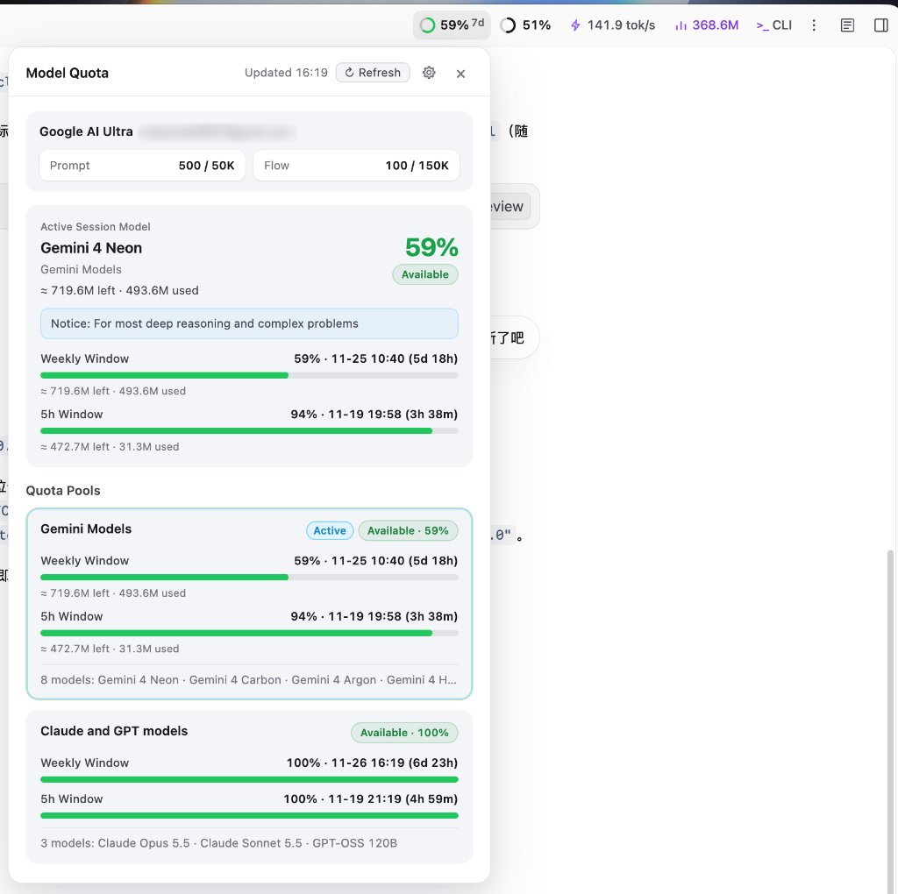
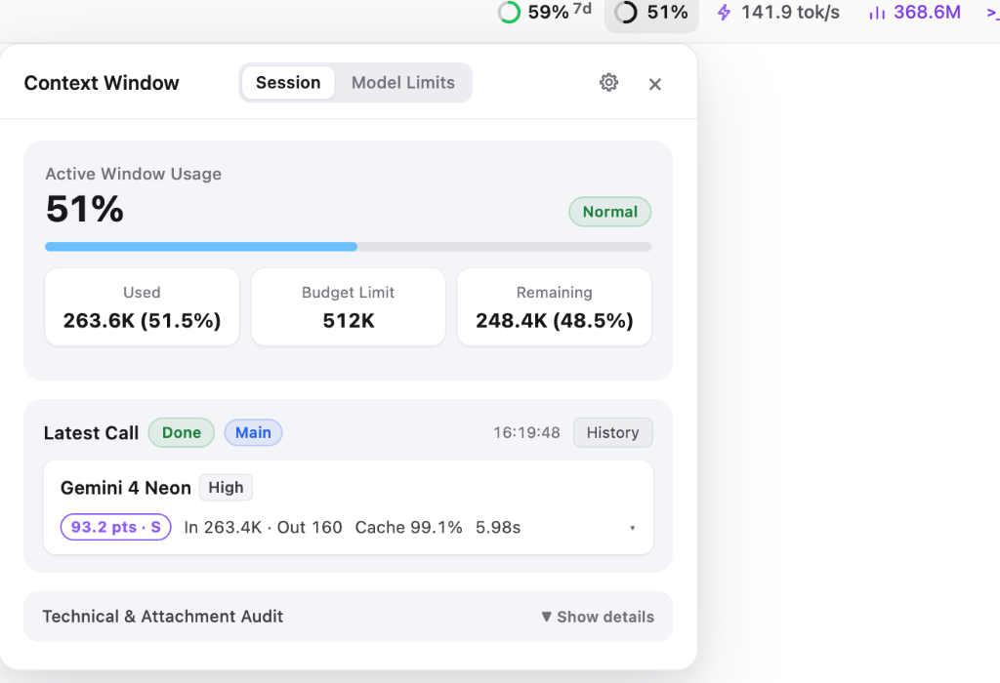

# agy-usage

[English](README.md) · **简体中文**

面向 macOS 和 Linux 的 Antigravity 桌面客户端顶栏监控面板。零外部 npm 依赖、无外网请求，在客户端顶栏提供模型额度、上下文窗口占用、生成速度与累计 Token 用量的实时视图。

## 界面预览

| 模型额度 | 上下文窗口 |
| :---: | :---: |
|  |  |

## 功能概览

顶栏提供四个独立入口，点击分别打开对应的专属浮层：

1. **模型额度**
   - 顶栏动态圆环展示当前模型剩余额度；浮层内显示订阅等级、各共享额度池余量与重置倒计时。
2. **上下文窗口**
   - 展示当前会话实际占用、预算上限、剩余空间，以及最新一次调用的总输入、缓存读取占比与耗时；支持展开历史轮次时间线与本地附件估算。
   - 顶部可切换至「窗口规格」，查看各模型上下文窗口与最大输出参数。
3. **生成速度**
   - 展示最近一次生成的纯流式速度（`tok/s`）、首字延迟（TTFT）、总耗时与输出量，并在同一浮层内提供跨模型中位数对比柱状图与单模型历史趋势折线图。
4. **累计 Token 用量**
   - 区分 **全部 / 桌面端 / CLI** 三组数据来源，统计累计、今日、本月、年度用量及缓存命中占比。
   - 内置 52 周活跃热力图（按天 / 周 / 月 / 年 / 累计总量）、按模型 / 档位堆叠分布，以及基于公开单价的 API 参考金额与自定义 USD 月度实付对比。

其他实用功能：

- **快捷启动 CLI**：顶栏点击 `CLI` 直接在当前项目目录拉起 `agy` 终端（macOS 优先使用 `Kitty.app`，未安装时回退 `Terminal.app`）。
- **外观与语言**：面板支持 `EN / 简 / 繁` 切换（默认英文，不修改宿主自身语言）；支持 `跟随宿主 / 深色 / 浅色` 主题、5 套配色方案与顶栏指标显隐开关。

## 工作方式

- 面向 **macOS 与 Linux**，仅读取本地会话日志、归档文件以及本机 `127.0.0.1` 宿主接口。
- 不修改 `language_server` / `agy` 二进制文件，不拦截或篡改聊天请求，不读取 OAuth Token 或 Keychain 凭据，也不发起任何外网连接。

## 环境要求

- Node.js `>= 22.4.0`（内嵌原生 ASAR 引擎，无需 `npm install`）
- Python 3（可选，用于分析会话中的 Office / PDF 附件）
- macOS 或 Linux 版 Antigravity 桌面客户端

## 安装与使用

### 方式一：复制给 AI 助手一键安装

将以下提示词直接复制发给你的 AI 编程助手（Antigravity、Claude Code、Codex、Cursor 等）：

```text
请克隆 https://github.com/StepaniaH/agy-usage（如果我本地已有仓库则直接进入目录），阅读仓库里的 AGENTS.md，依次执行 `node cli.js check` 和 `node cli.js install` 完成安装，然后提示我手动重启 Antigravity，并在我重启后用 `node cli.js status` 验证安装状态。请不要自动强杀正在运行的 Antigravity 进程。
```

### 方式二：手动命令行安装

```bash
git clone https://github.com/StepaniaH/agy-usage.git
cd agy-usage

# 1. 环境预检（检测 Node 版本、Antigravity app.asar 路径与 Python）
node cli.js check

# 2. 持久化写入 app.asar（自动备份原文件并做 SHA-256 校验）
node cli.js install

# 3. 完全退出并重启 Antigravity 后，检查生效状态
node cli.js status
```

也可直接运行根目录快捷脚本：

```bash
./install.sh     # 安装或更新
./uninstall.sh   # 还原原始 app.asar
```

### 其他子命令

```bash
node cli.js install --path "<path-to-app.asar>"  # 指定自定义 app.asar 路径
node cli.js restore                               # 从备份无损还原（或原位剥离注入标记）
node cli.js live                                  # 通过本地 CDP 调试端口免改盘热注入当前窗口
node cli.js watch                                 # 免改盘后台守护进程，监听本地 CDP 窗口自动挂载
node cli.js stop-watch                            # 停止 watch 守护进程与本地桥接服务
```

> Antigravity 桌面客户端自动升级新版本时会替换 `app.asar`，升级后重新执行一次 `node cli.js install`（或 `./install.sh`）并重启客户端即可恢复。

## 开发与测试

渲染层源码位于 `src/renderer/`，`meter-renderer.js` 为构建生成的单文件产物：

```bash
# 重新构建 meter-renderer.js
npm run build:renderer

# 运行全部 Node.js 单测
npm test

# 运行 Python 附件扫描测试
python3 -m unittest attachment_scan_test.py

# 校验发布清单并生成 macOS / Linux 离线压缩包
node scripts/check-release-manifest.js
npm run pack
```

## 目录结构

```text
.
├── cli.js                        # CLI 入口（check / install / status / restore / live / watch）
├── install.js / restore.js       # ASAR 持久化注入与无损还原调度
├── modular-installer.js          # 最小化挂载代码生成与旧补丁原位清洗
├── asar-engine.js                # 原生 Node.js ASAR 解包/封包引擎
├── meter-main.js                 # Electron 主进程 IPC 桥接
├── live-host.js / local-api.js   # 本地 127.0.0.1 调试端口与免改盘运行时桥接
├── meter-core.js                 # 上下文估算、缓存统计、速度评分与计价核心
├── meter-collector.js            # 本地会话归档、transcript.jsonl 与 SQLite 采集
├── meter-storage.js              # 原子写入与配置自愈存储
├── meter-cli-launcher.js         # macOS / Linux 终端与 agy CLI 启动器
├── attachment_scan.py            # 可选 Python 附件分析脚本
├── src/renderer/                 # 模块化渲染层源码（各领域视图、样式、模板与多语言）
├── meter-renderer.js             # 由 scripts/build-renderer.js 生成的渲染层单文件产物
├── scripts/                      # 渲染构建、清单校验、离线打包与扫描基准测试
├── LICENSE                       # MIT 开源协议
└── NOTICE                        # 上游来源与修改说明
```

## 开源协议与来源说明

本项目采用 [MIT License](LICENSE)。

本项目基于开源项目 [elviscjn-cjn/antigravity-context-viewer](https://github.com/elviscjn-cjn/antigravity-context-viewer)（MIT License，Copyright (c) 2026 Antigravity Context Viewer Contributors）精简与重构而来，面向 macOS 与 Linux 平台。完整版权声明与衍生改动摘要见 [LICENSE](LICENSE) 与 [NOTICE](NOTICE)。
